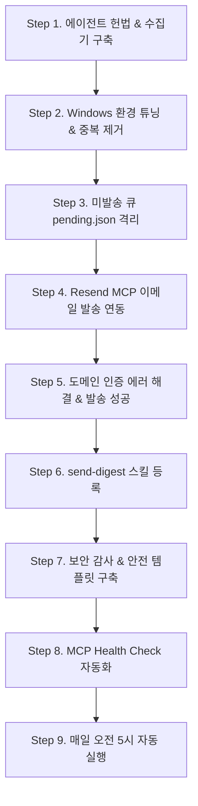

# 📡 URL Monitor & Digest Agent

지정된 테크/산업 인사이트 소스(SemiAnalysis 등)의 신규 업데이트를 실시간 추적하고, 원문을 일일이 열지 않고도 핵심을 즉시 파악할 수 있도록 **[제목 · 3문장 팩트 요약 · 원문 URL]**로 구조화하여 브리핑 및 이메일 다이제스트를 자동 발송하는 **자율형 웹 모니터링 AI 에이전트 시스템**입니다.

---

## 🎯 프로젝트 소개 및 주요 기능

### 1. 프로젝트 목적
수많은 전문 기술 뉴스레터와 리포트 중 필요한 핵심 정보를 놓치지 않으면서도 정보 과부하를 방지하기 위해, **'팩트 중심의 요약'**과 **'중복 없는 엄격한 상태 관리'**를 원칙으로 작동하는 모니터링 에이전트를 구축했습니다.

### 2. 주요 기능
- **자동 수집 & 기간 필터링**: `config/config.yaml`의 기간(`start` ~ `end`) 내 게시글 자동 탐색 및 URL 유효성 검증. `end`를 비워 두면 실행 시점까지 계속 추적
- **매일 자동 실행 (2026-10-03 추가)**: Windows 작업 스케줄러가 매일 오전 5시에 `run_daily.py`를 실행해 수집 → `index.html` 데이터 갱신 → 새 글 메일 발송까지 자동 처리
- **팩트 중심의 3문장 요약**: 원문 기반 사실만을 3문장 이내 한국어로 재작성 (유료 구독 글은 "원문 확인 필요" 투명 명시)
- **엄격한 중복 제거 (Deduplication)**: `data/state/seen.json`과 `data/items/*.jsonl`을 기반으로 이미 처리한 URL 원천 차단
- **미발송 큐(Pending Queue) 관리**: 수집 목록과 발송 이력(`sent.json`)을 비교하여 새 항목만 `docs/pending.json`으로 격리
- **Resend MCP 기반 이메일 다이제스트**: 카드형 반응형 HTML 및 텍스트 템플릿으로 구조화된 요약본을 수신자에게 자동 발송
- **웹 대시보드 연동**: 수집된 아티클과 상세 분석 내용을 한눈에 확인할 수 있는 인터랙티브 대시보드 (`index.html`)
- **에이전트 규칙 & 스킬 시스템**: 에이전트 행동 지침(헌법) 및 재사용 가능한 커스텀 스킬 등록 (`send-digest`, `summarize-item`)
- **보안 감사 및 자가 진단**: 원클릭 스크립트(`scripts/check_mcp_health.py`)를 통해 MCP 연동 상태 및 Git 유출 위험 실시간 감사

---

## 🛠 사용 기술 스택

| 영역 | 기술 / 도구 | 용도 및 설명 |
| :--- | :--- | :--- |
| **Agent Platform** | **Google Antigravity (AGY)** | 에이전트 런타임, 커스텀 스킬 & 규칙 기반 자율 실행 |
| **Language & Runtime**| **Python 3.14**, **Node.js (npx)** | 코어 파이프라인 스크립트 실행 및 MCP 서버 호스팅 |
| **Agent Protocol** | **Model Context Protocol (MCP)** | 외부 도구 표준 연동 (`firecrawl-mcp`, `resend-mcp`) |
| **Email Infrastructure** | **Resend API** | 트랜잭셔널/다이제스트 이메일 발송 (`@resend/mcp-server`) |
| **Data Pipeline** | **JSONL / JSON / YAML** | `seen.json`, `sent.json`, `pending.json` 상태 머신 관리 |
| **Security & Auditing** | **Git / Pre-flight Script** | API Key 격리, 다중 `.gitignore`, 자가 진단 리포트 |
| **Web UI** | **Modern HTML5, Vanilla CSS** | 모니터링 현황 및 보고서 열람 인터랙티브 대시보드 |

---

## 📈 개발 과정 (시간순 바이브 코딩 로그)

사용자와 AI 에이전트가 실시간으로 소통하며 모니터링 헌법 수립부터 보안 강화까지 완성한 전체 개발 과정입니다.



### Step 1. 에이전트 헌법(Mission & Principles) 수립
- 에이전트 행동 지침(`.agents/rules/url-monitor.md`, `mission.md`) 정의:
  1. *새 항목만 다룬다.* (이미 처리한 항목 재처리 금지)
  2. *사실만 쓴다.* (원문 내용 기반 3문장 이내, 추측/평가 배제)
  3. *모든 항목에 원문 URL 필수 포함*
  4. *원문 단순 복사 금지* (내 말로 재작성)
  5. *실패 시 이유를 명확히 고지*
- SemiAnalysis Substack 아카이브 API 수집기(`monitor.py`) 구현.

### Step 2. 환경 호환성 대응 및 중복 제거(Dedup) 파이프라인 구현
- **시행착오**: Windows PowerShell 환경에서 `python3` 명령어가 Microsoft Store 스텁 실행 파일로 연결되어 오류가 발생하는 현상 발견.
- **해결**: `python` 및 `py` 명령어를 표준으로 설정하고 인코딩(`PYTHONIOENCODING=utf-8`) 문제를 사전에 방지하도록 파이썬 스크립트 내 `sys.stdout.reconfigure(encoding="utf-8")` 안전장치 마련.
- `scripts/dedup.py`를 실행하여 수집된 44개 기사의 URL 중복을 완전히 제거하고 `data/state/seen.json` 동기화 완료.

### Step 3. 미발송 큐(`pending.json`) 상태 격리
- 전체 수집 목록(`docs/items.json`)과 기발송 목록(`data/state/sent.json`) 간 차집합을 연산하는 `scripts/pending.py` 작성.
- 발송 대상 44건을 추출하여 `docs/pending.json`으로 격리 저장.

### Step 4. Resend MCP 설정 및 이메일 템플릿 개발
- 메일 설정 분리: `config/email.yml`에 수신자(`recipient`)와 제목 머리말(`subject_prefix`) 정의.
- MCP 설정: `mcp_config.json` 및 `.agents/mcp_config.json`에 최신 `resend-mcp` 패키지 구성 추가.
- `[제목] · [핵심 요약] · [URL]` 형식의 깔끔한 카드형 HTML 및 텍스트를 구성하는 `scripts/send_email.py` 구현.

### Step 5. [핵심 시행착오] Resend 도메인 미인증(403) 해결 및 발송 성공
- **문제 발생**: 초기 설정된 외부 이메일(`owner@example.com`)로 발송 시도 시 Resend API에서 HTTP 403 오류 반환:
  > *"You can only send testing emails to your own email address (test@example.com). To send emails to other recipients, please verify a domain..."*
  - Resend의 기본 테스트 발송 주소(`onboarding@resend.dev`)는 가입 계정 본인 이메일로만 발송이 허용되는 정책 때문이었습니다.
- **의사결정**: 에이전트가 즉각 원인을 안내하고 사용자에게 확인 질문(`ask_question`)을 제공 → 사용자가 계정 이메일(`test@example.com`)로 테스트 발송 승인.
- **결과**: **이메일 발송 성공! (Resend Email ID: `01a0f2ce-681e-72d8-821d-366105baa156`)**
  - 발송 후 `data/state/sent.json`에 44건 자동 등록 완료.
  - `docs/pending.json`은 자동으로 비우기(`[]`) 완료.

### Step 6. 워크플로 스킬화 (`send-digest` & `mark_sent.py`)
- 반복되는 다이제스트 발송 작업을 Antigravity 정식 스킬로 정의:
  - [`.agents/skills/send-digest/SKILL.md`](file:///C:/practice/Website_agent/url-monitor/.agents/skills/send-digest/SKILL.md)
- 발송 확정 후 상태를 기록하는 [scripts/mark_sent.py](file:///C:/practice/Website_agent/url-monitor/scripts/mark_sent.py) 구축.

### Step 7. 보안 감사 및 Git 유출 방지 조치
- **문제 발견**: `mcp_config.json`과 `.agents/mcp_config.json`에 실제 API Key(`FIRECRAWL_API_KEY`, `RESEND_API_KEY`)가 평문으로 저장되어 있었으며, 심지어 `.agents/mcp_config.json`이 Git Staging 영역에 올라가 있어 커밋 시 외부에 유출될 위험이 포착됨.
- **해결 조치**:
  1. Git 캐시에서 즉시 강제 언스테이징: `git rm --cached -f .agents/mcp_config.json`
  2. [`.gitignore`](file:///C:/practice/Website_agent/url-monitor/.gitignore)에 `mcp_config.json`과 `.agents/mcp_config.json`, `*.env`를 명시적으로 추가하여 원격 업로드 완전 차단.
  3. Git에 안전하게 커밋 가능한 배포용 예제 템플릿([`.env.example`](file:///C:/practice/Website_agent/url-monitor/.env.example), [`mcp_config.example.json`](file:///C:/practice/Website_agent/url-monitor/mcp_config.example.json)) 제작.

### Step 8. MCP 동작 및 보안 자가 진단(Health Check) 자동화
- MCP JSON 스키마 유효성, 환경 변수 키 등록 여부, Git 누출 상태를 자동으로 전수 검사하는 [scripts/check_mcp_health.py](file:///C:/practice/Website_agent/url-monitor/scripts/check_mcp_health.py) 구축.
- 실행 결과: 모든 서버 정상 동작 확인 및 **Git 추적 100% 격리(안전)** 확인.

### Step 9. 매일 오전 5시 자동 실행 (2026-10-03)
- **목표**: 하루에 한 번 새 글을 수집해 `index.html`을 갱신하고, 새로 올라온 내용을 지정된 메일로 발송.
- **점검 중 발견한 문제와 해결**:
  1. **수집 기간이 끝나 있음**: `monitor.py`에 기간 끝이 `2026-09-28`로 하드코딩되어 있어 매일 돌려도 새 글을 0건만 가져오는 상태였음.
     → 기간을 `config/config.yaml`의 `period`에서 읽도록 바꾸고, `end`를 비우면 실행 시점까지 추적하도록 변경.
  2. **`index.html` 데이터가 갱신되지 않음**: `monitor.py`가 존재하지 않는 함수 `build_dashboard.build_dashboard`를 불러 오류가 경고로만 출력되고 넘어가고 있었음.
     → `build_dashboard.build_all()` 호출로 수정. 이제 수집 후 `assets/data.js`(index.html이 읽는 데이터)와 `docs/`가 함께 갱신됨.
  3. **발송 실패가 성공으로 처리됨**: `scripts/send_email.py`가 실패해도 정상 종료(exit 0)하여, 뒤에 `mark_sent.py`를 붙이면 보내지 못한 글이 '발송됨'으로 기록될 위험이 있었음.
     → 실패 시 exit 1로 끝나도록 수정. 발송 기록은 `send_email.py`가 성공했을 때만 `sent.json`에 남기므로, 일일 실행에서는 `mark_sent.py`를 쓰지 않음.
  4. **Windows 콘솔 인코딩(cp949) 오류**: 작업 스케줄러에서 로그의 기호(✔ 등) 출력 시 `UnicodeEncodeError` 발생 → stdout/stderr를 UTF-8로 재설정.
- **추가한 파일**: [`run_daily.py`](file:///C:/practice/Website_agent/url-monitor/run_daily.py) — 수집 → 중복 제거 → 대시보드 데이터 → 미발송 목록 → 메일 발송을 순서대로 실행. 한 단계라도 실패하면 거기서 멈추고, 실행 기록을 `logs/daily_YYYY-MM-DD.log`에 남김.
- **자동 실행 등록**: Windows 작업 스케줄러 작업 `URL Monitor Daily`를 매일 오전 5시로 등록.
  - 그 시각에 PC가 꺼져 있었으면 다음에 켜질 때 실행, 인터넷 연결 시에만 실행, 최대 30분 제한.
  - Windows에 로그인되어 있어야 실행됨.
- **검증 결과**: 작업 스케줄러로 직접 실행 → 결과 코드 0, 5단계 모두 완료.
  - 9/28 이후 SemiAnalysis 새 글이 실제로 없어(아카이브 API로 확인) 수집 0건, 메일은 발송하지 않음. 실제 메일 발송은 다음 새 글이 올라올 때 처음 확인됨.
- **남은 과제**:
  - 새 글의 요약은 `monitor.py`에 직접 적어 둔 한국어 요약이 없으면 원문 영어 부제가 그대로 들어감. 한국어 제목·분류(`enrich.json`)도 새 글에는 비어 있음.
  - `config/email.yml`에 `recipient`가 두 번 적혀 있어 마지막 값(`test@example.com`, 테스트 주소)이 쓰임. Resend 도메인 인증 후 `owner@example.com` 한 줄만 남길 것.
  - PC가 꺼져 있어도 돌리려면 GitHub Actions 워크플로로 옮겨야 함 (아직 GitHub 원격 저장소 없음).

---

## 📂 프로젝트 구조

```text
url-monitor/
├── .agents/
│   ├── rules/                 # 에이전트 행동 지침 및 원칙 (mission.md, url-monitor.md 등)
│   ├── skills/                # Antigravity 전용 커스텀 스킬
│   │   ├── send-digest/       # 다이제스트 메일 발송 스킬 (SKILL.md)
│   │   └── summarize-item/    # 3문장 팩트 요약 스킬 (SKILL.md)
│   └── mcp_config.json        # 에이전트용 MCP 설정 (로컬 전용, .gitignore 처리)
├── config/
│   ├── config.yaml            # 모니터링 소스 및 수집 기간 설정 (end 비우면 계속 추적)
│   └── email.yml              # 이메일 수신자 및 제목 머리말 설정
├── data/
│   ├── items/                 # 월별 원본 수집 데이터 (*.jsonl)
│   ├── state/
│   │   ├── seen.json          # 수집 완료된 고유 URL 세트
│   │   └── sent.json          # 발송 완료된 URL 세트 (중복 발송 방지)
│   └── summaries.json         # slug 별 한국어 요약 캐시 (summarizer.py)
├── docs/
│   ├── items.json             # 웹 대시보드용 전체 항목 데이터
│   ├── pending.json           # 발송 대기 중인 신규 항목 큐
│   └── index.html             # GitHub Pages 호환 웹 리포트
├── output/
│   └── results.json           # 수집 및 요약 최종 결과물
├── scripts/
│   ├── dedup.py               # JSONL·seen.json 및 results.json 중복 제거
│   ├── build_dashboard.py     # data/items/*.jsonl → docs/items.json
│   ├── backfill_summaries.py  # 한국어 요약이 없는 글을 Claude API 로 요약 (--dry-run / --limit N)
│   ├── pending.py             # 미발송 항목 필터링 (items - sent)
│   ├── send_email.py          # Resend API 기반 다이제스트 발송
│   ├── mark_sent.py           # 발송 완료 상태 갱신
│   └── check_mcp_health.py    # MCP 동작 및 보안 상태 자가 진단 스크립트
├── .env                       # API Key 로컬 환경 변수 (.gitignore 처리)
├── .env.example               # Git 공유용 환경 변수 안전 템플릿
├── mcp_config.json            # 프로젝트 루트 MCP 설정 (로컬 전용, .gitignore 처리)
├── mcp_config.example.json    # Git 공유용 MCP 설정 안전 템플릿
├── .gitignore                 # 보안 및 임시 파일 제외 목록
├── build_site.py              # assets/data.js 생성 + HTML·assets 를 docs/ 로 동기화
├── index.html                 # 메인 웹 브라우징 화면 (데이터는 assets/data.js)
├── logs/                      # 일일 실행 기록 daily_YYYY-MM-DD.log (.gitignore 처리)
├── monitor.py                 # 코어 모니터링 & 요약 수집기
├── summarizer.py              # Claude API 요약기 (캐시: data/summaries.json, 키: ANTHROPIC_API_KEY)
├── run_daily.py               # 매일 자동 실행되는 전체 파이프라인
└── README.md                  # 본 문서
```

---

## 🚀 실행 방법

### 1. 사전 환경 준비
1. **Python**: 3.10 이상 권장 (`python --version`)
2. **Node.js**: Resend/Firecrawl MCP 구동용 (`node --version`)
3. **환경 변수 설정**: 
   - [`.env.example`](file:///C:/practice/Website_agent/url-monitor/.env.example)을 복사하여 `.env`를 생성하고 발급받은 API 키를 입력합니다.
   ```powershell
   Copy-Item .env.example .env
   ```
   ```env
   RESEND_API_KEY=re_your_resend_api_key_here
   FIRECRAWL_API_KEY=fc-your_firecrawl_api_key_here
   ```
4. **이메일 설정**: `config/email.yml`에서 수신자 정보를 확인/수정합니다.
   ```yaml
   recipient: your_email@example.com
   subject_prefix: "[모니터링+테스트]"
   ```

---

### 2. 매일 자동 실행 (2026-10-03 추가)

전체 파이프라인을 한 번에 실행:
```powershell
python run_daily.py
```

Windows 작업 스케줄러 등록 (매일 오전 5시):
```powershell
$action = New-ScheduledTaskAction -Execute 'C:\Python314\python.exe' -Argument '"C:\practice\Website_agent\url-monitor\run_daily.py"' -WorkingDirectory 'C:\practice\Website_agent\url-monitor'
$trigger = New-ScheduledTaskTrigger -Daily -At '05:00'
$settings = New-ScheduledTaskSettingsSet -StartWhenAvailable -AllowStartIfOnBatteries -DontStopIfGoingOnBatteries -RunOnlyIfNetworkAvailable -ExecutionTimeLimit (New-TimeSpan -Minutes 30)
Register-ScheduledTask -TaskName 'URL Monitor Daily' -Action $action -Trigger $trigger -Settings $settings
```

| 하고 싶은 일 | 명령 |
| :--- | :--- |
| 지금 바로 한 번 실행 | `Start-ScheduledTask -TaskName 'URL Monitor Daily'` |
| 마지막 실행 결과·다음 실행 시각 | `Get-ScheduledTaskInfo -TaskName 'URL Monitor Daily'` |
| 자동 실행 끄기 | `Unregister-ScheduledTask -TaskName 'URL Monitor Daily'` |
| 실행 기록 보기 | `logs/daily_YYYY-MM-DD.log` |

---

### 3. 단계별 파이프라인 실행 (수동)

#### Step 0: 사전 진단 (MCP 및 보안 상태 확인)
```powershell
python scripts/check_mcp_health.py
```
- MCP 설정 유효성, API Key 존재 여부, Git 격리 상태를 일괄 점검합니다.

#### Step 1: 웹 모니터링 및 요약 데이터 수집
```powershell
python monitor.py
```
- `config/config.yaml`의 `sources`(각 소스는 `label`·`url`·`archive` 주소)에서 신규 기사를 수집하고 3문장 팩트 요약을 생성합니다.
- `data/state/seen.json`이 '이미 처리한 URL'의 단일 기준입니다 (없으면 `output/results.json`에서 복구).
- 수집만 하며 사이트(`assets/data.js`, `docs/`)는 갱신하지 않습니다. 전체 갱신은 `python run_daily.py` 또는 `python build_site.py`를 사용하세요.

#### Step 2: 중복 제거 및 수집 상태(`seen.json`) 갱신
```powershell
python scripts/dedup.py
python scripts/build_dashboard.py   # docs/items.json
python build_site.py              # assets/data.js + docs/ 동기화
```
- 수집된 항목 중 중복 URL을 정리하고 고유 항목 목록을 확정한 뒤, 사이트 데이터를 만듭니다.

#### Step 3: 미발송 큐(`pending.json`) 추출
```powershell
python scripts/pending.py
```
- 아직 이메일로 발송되지 않은 신규 항목만 골라 `docs/pending.json`에 저장합니다.

#### Step 4: 이메일 다이제스트 발송
```powershell
python scripts/send_email.py
```
- `docs/pending.json`의 내용을 `[제목 · 요약 · URL]` 카드 형태로 포맷팅하여 Resend를 통해 발송합니다.
- 발송이 성공하면 `data/state/sent.json`이 자동 갱신되고 `docs/pending.json`은 비워집니다.

#### Step 5: 웹 대시보드 열람
- 브라우저에서 `index.html`을 열어 수집된 분석 결과를 시각적으로 확인합니다.

---

## 🔒 보안 아키텍처 및 비밀 키 관리 가이드

### 1. 4중 비밀 키 보호 원칙
1. **단일 공급원 집중화**: 모든 실제 API Key는 [`.env`](file:///C:/practice/Website_agent/url-monitor/.env) 및 로컬 전용 설정 파일에서만 관리합니다.
2. **원천 격리 ([.gitignore](file:///C:/practice/Website_agent/url-monitor/.gitignore))**:
   - `.env`, `*.env`, `mcp_config.json`, `.agents/mcp_config.json`이 Git 추적 대상에서 완전히 제외되어 있습니다.
3. **안전한 배포 템플릿**:
   - Git 저장소에는 실제 키가 제거된 [`.env.example`](file:///C:/practice/Website_agent/url-monitor/.env.example) 및 [`mcp_config.example.json`](file:///C:/practice/Website_agent/url-monitor/mcp_config.example.json)만 올라갑니다.
4. **지속적 감사**:
   - `python scripts/check_mcp_health.py`를 통해 언제든 누출 위험을 사전에 검사할 수 있습니다.

### 2. GitHub 업로드 및 CI/CD 연동 시 동작 방식
- **GitHub 저장소에 Push할 때**:
  - 실제 API Key는 사용자의 로컬 컴퓨터에만 남으며, GitHub 원격 저장소에는 업로드되지 않습니다.
  - 새 환경에서 프로젝트를 `git clone`한 사용자는 `.env.example`을 참고해 본인의 API 키를 입력하여 사용합니다.
- **GitHub Actions 자동화 시**:
  - GitHub 저장소의 `Settings` → `Secrets and variables` → `Actions`에 `RESEND_API_KEY`, `FIRECRAWL_API_KEY`를 비밀 변수로 등록하여 안전하게 구동합니다.
- **외부 수신자 메일 발송 시**:
  - 테스트 발송 주소(`onboarding@resend.dev`)는 가입자 본인 이메일로만 발송됩니다. 외부 수신인(예: 회사 동료, 클라이언트)에게 발송하려면 [Resend Domains](https://resend.com/domains)에서 본인 도메인 인증 후 발송자(from) 주소를 지정해야 합니다.
