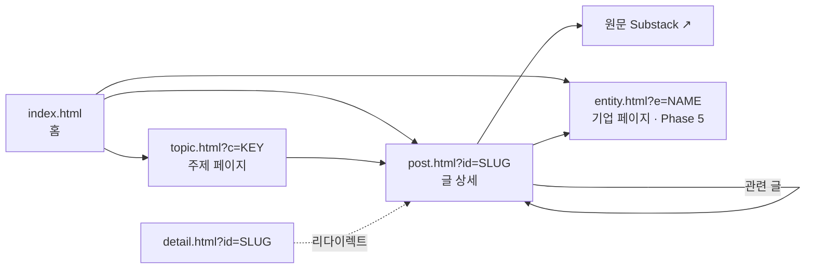

# SemiAnalysis 포스트 모니터 — 사이트 개편 스펙

> **[2026-10-27 폐기] 다중 페이지 계획(`topic/post/entity/detail.html`, `assets/app.js`·`app.css`)은 구현하지 않기로 하고 해당 파일을 삭제했다.** 현재 사이트는 3분할 단일 페이지 `index.html`뿐이다(CLAUDE.md 참고). 이 문서는 디자인 토큰(3장) 등 참고용으로만 남긴다.

> Claude Code 작업 지시서. 저장소 루트에 두고 `SITE_SPEC.md를 읽고 Phase 1부터 진행해` 식으로 사용한다.
> 각 Phase는 독립적으로 머지 가능해야 하며, Phase 끝의 **완료 조건**을 모두 통과해야 다음 Phase로 넘어간다.

---

## 0. 배경과 원칙

### 현재 상태 (사실)
- `index.html`: 단일 파일 게시판. 데이터(44건)를 `<script>` 안 JSON으로 임베드, HTTP로 서빙될 때는 `output/results.json`을 fetch해 덮어씀.
- 각 글 링크는 `detail.html?id=<slug>` 로 연결됨 → **현재 이 상세 페이지가 없거나 목록 페이지로 덮어써진 상태(깨진 링크).**
- 한글 제목·주제는 `enrich.json`(slug → `{ko, c}`) 매핑으로 부여됨.

### 데이터 제약 (사실)
| 항목 | 상태 | 영향 |
|---|---|---|
| 본문 | 44건 중 43건 유료, 본문 없음 | 상세 페이지에 채울 정보가 부족 |
| `summary` | 한글 문장 요약 / 영문 키워드 나열 혼재 | 그대로 노출 시 스캔 어려움 |
| `detected_at` | 42건이 동일 날짜(최초 일괄 수집) | 날짜 그룹핑 무의미 |
| 발행일 | 필드 없음 | 최신순 정렬 신뢰 불가 |
| 기업·제품 | 필드 없음 | 기업별 모아보기 불가 |

### 설계 원칙
1. **UI보다 데이터 보강이 먼저**다. 화면은 있는 필드만 쓰고, 없는 필드는 숨긴다(빈 박스 금지).
2. 사실과 추정을 분리한다. LLM 생성 필드는 UI에 `제목·미리보기 기반 요약` 라벨을 붙인다.
3. 프레임워크 도입 금지(현 규모 44건·4페이지). Vanilla JS + 공유 JS/CSS 파일. 빌드 체인 없음.
4. 모든 페이지는 `file://` 로 열어도 동작해야 한다(임베드 데이터 폴백 유지).

---

## 1. 목표 사이트 구조



| 페이지 | 3초 안에 전달할 것 | 구성 |
|---|---|---|
| `index.html` | 무엇이 새로 나왔나 | 새 글 하이라이트, 주제 카드 6개(카드당 최신 3건), 검색 |
| `topic.html` | 이 주제의 지금 쟁점 | 주제 설명 1줄, 상위 키워드 칩, 글 목록 |
| `post.html` | 무엇에 대한 글이고 왜 중요한가 | 한 줄 요지, 핵심 포인트 3개, 기업 태그, 키워드 칩, 관련 글 |
| `entity.html` | 특정 기업·기술 관련 흐름 | 기업명, 글 수, 시간순 목록 |

### 파일 레이아웃 (목표)
```
/
├─ index.html
├─ topic.html
├─ post.html
├─ detail.html          # post.html로 리다이렉트만 (하위 호환)
├─ entity.html          # Phase 5
├─ assets/
│  ├─ app.css           # 공통 디자인 토큰·컴포넌트
│  ├─ app.js            # 공통 유틸·데이터 로더·렌더 함수
│  └─ data.js           # window.POSTS = [...] (file:// 폴백용, 빌드 스크립트로 생성)
├─ output/results.json  # 수집 파이프라인 산출물 (원천)
├─ enrich.json          # slug → 한글 제목·주제 수동 매핑
└─ scripts/build_data.py  # results.json + enrich.json → assets/data.js
```

---

## 2. 데이터 스키마

### 목표 레코드 (`results.json` 확장)
```json
{
  "slug": "long-live-the-short-king-why-4-hi",
  "title": "Long Live the Short King: Why 4-hi HBM Wins",
  "title_ko": "4단 HBM이 고적층보다 유리한 이유",
  "category": "mem",
  "summary": "원본 summary 문자열 (유지)",
  "takeaway": "4-hi 적층이 원가·수율에서 8-hi 이상보다 유리하다는 주장",
  "points": ["...", "...", "..."],
  "entities": ["SK hynix", "Micron", "HBM4"],
  "keywords": ["4-hi", "TSV", "yield"],
  "paywalled": true,
  "published_at": "2026-09-20T13:00:00Z",
  "detected_at": "2026-09-28T14:51:55Z",
  "url": "https://newsletter.semianalysis.com/p/long-live-the-short-king-why-4-hi",
  "source": "https://semianalysis.com/"
}
```

### 필드 규칙
| 필드 | 필수 | 출처 | 비고 |
|---|---|---|---|
| `slug` | ✅ | `url` 마지막 경로 세그먼트 | 기존 `slugOf()`와 동일 규칙 |
| `title`, `url`, `source`, `detected_at` | ✅ | 기존 | 변경 없음 |
| `title_ko`, `category` | ✅ | `enrich.json` → 없으면 `guessCat()` | 기존 로직 유지 |
| `summary` | ✅ | 기존 | `(상세 본문은 유료 구독 필요, 원문 확인 필요)` 꼬리표는 렌더 시 제거 |
| `paywalled` | ✅ | 수집 시 boolean 저장 | 없으면 기존 `isPaid()` 문자열 추론으로 폴백 |
| `published_at` | ⭕ | Substack RSS `pubDate` | 있으면 정렬·표시 기준, 없으면 `detected_at` |
| `keywords` | ⭕ | summary가 키워드 나열형이면 `,`로 분리 | 기존 `parseSummary()` 결과 재사용 |
| `takeaway`, `points` | ⭕ | LLM 생성 (제목+무료 미리보기만 입력) | **추정** — UI 라벨 필수 |
| `entities` | ⭕ | 사전 매칭 우선, LLM 보조 | 아래 사전 사용 |

### 개체 사전 (초기값, `assets/app.js`에 상수로)
```js
const ENTITIES = {
  'NVIDIA':   ['nvidia', 'blackwell', 'rubin', 'gb200', 'gb300', 'cuda'],
  'AMD':      ['amd', 'mi355', 'mi455', 'helios'],
  'Intel':    ['intel', '18a', 'panther lake', 'emib'],
  'Google':   ['google', 'tpu', 'gemini', 'gcp'],
  'Meta':     ['meta '],
  'OpenAI':   ['openai', 'jalape'],
  'Anthropic':['anthropic'],
  'SK hynix': ['hynix'],
  'CXMT':     ['cxmt'],
  'SMIC':     ['smic'],
  'HBM':      ['hbm'],
  'DeepSeek': ['deepseek'],
};
```

---

## 3. 디자인 시스템 (변경 금지 — 기존 `index.html`에서 `assets/app.css`로 이동만)

### 토큰
```css
:root {
  --bg:#f5f6f9; --surface:#fff; --sunken:#eff1f6; --hover:#f9fafc; --chip:#eef1f6;
  --line:#e1e5ed; --line-soft:#eceff4;
  --text:#0f172a; --text-2:#475569; --muted:#687387;
  --accent:#4338ca; --accent-solid:#4f46e5; --accent-soft:#eef0ff; --accent-line:#c9cffc;
  --free-bg:#e6f5ec; --free-text:#166534; --mark:#fde68a;
  --c-mem:#0e7490; --c-chip:#7c3aed; --c-acc:#4f46e5; --c-model:#c2410c; --c-dc:#15803d; --c-biz:#b45309;
}
[data-theme="dark"] {
  --bg:#0c0c10; --surface:#14141a; --sunken:#1b1b23; --hover:#181820; --chip:#23232d;
  --line:#2a2a35; --line-soft:#20202a;
  --text:#f4f4f5; --text-2:#b9b9c3; --muted:#91919e;
  --accent:#a5b4fc; --accent-solid:#5b5ff0; --accent-soft:rgba(129,140,248,.14); --accent-line:rgba(129,140,248,.36);
  --free-bg:rgba(74,222,128,.12); --free-text:#86efac; --mark:rgba(250,204,21,.3);
  --c-mem:#22d3ee; --c-chip:#c4b5fd; --c-acc:#a5b4fc; --c-model:#fdba74; --c-dc:#86efac; --c-biz:#fcd34d;
}
```
- 폰트: Pretendard (jsDelivr CDN), 폴백 `-apple-system, 'Segoe UI', 'Noto Sans KR', sans-serif`
- 본문 `word-break: keep-all`
- 테마: `localStorage('theme')` → 없으면 `prefers-color-scheme`. `<head>` 인라인 스크립트로 FOUC 방지.

### 주제 정의 (그대로 유지)
| key | label | desc |
|---|---|---|
| `mem` | 메모리·HBM | HBM, DRAM, 오프로딩, 메모리 병목 |
| `chip` | 칩 설계·패키징 | 실물 분해, 공정, 패키징, 자체 칩 |
| `acc` | GPU·가속기 추론 | 추론 성능·TCO 벤치마크, CUDA 생태계 |
| `model` | AI 모델·소프트웨어 | 모델 아키텍처, RL, 컴파일러 |
| `dc` | 데이터센터·전력 | 전력망, 건설·인허가, 신규 입지 |
| `biz` | 클라우드·기업·자본 | 네오클라우드, 빅테크 전략, 재무 |

### 가독성 규칙
| 규칙 | 적용 |
|---|---|
| 한글 제목 1순위, 원문 제목 2순위(작게, `--muted`) | 모든 목록·상세 |
| 한 화면 강조 요소 1개 | `post.html`의 한 줄 요지 블록만 accent 배경 |
| 유료/무료 배지는 소수(무료)에만 | 목록 |
| 주제 색은 막대·점에만, 텍스트에 사용 금지 | 전체 |
| 상세 본문 최대폭 680px | `post.html` |
| 영문 키워드는 칩으로 | 키워드 영역 |
| 날짜는 날짜만(`YYYY-MM-DD` 또는 `M/D`), 시각 표시 금지 | 전체. 라벨은 발행일 있으면 `발행`, 없으면 `수집` |
| 추정 필드는 라벨 표시 | `takeaway`, `points` 위 `제목·미리보기 기반 요약` |
| 데이터 없는 섹션은 렌더하지 않음 | 전체 |

---

## 4. 공통 모듈 (`assets/app.js`) API

기존 `index.html` 인라인 스크립트에서 아래를 추출해 공유한다. 전역 네임스페이스 `window.SA`.

```js
SA.CATS, SA.CAT_BY_KEY, SA.ENTITIES
SA.loadPosts(): Promise<Post[]>      // 1) fetch('output/results.json') 2) 실패 시 window.POSTS
SA.normalize(raw): Post               // slug, title_ko, category, paywalled, keywords, entities 보정
SA.slugOf(p), SA.isPaid(p), SA.parseSummary(s), SA.guessCat(p)
SA.dateLabel(p): string               // '발행 9/20' | '수집 9/28'
SA.esc(s), SA.highlight(s, q)
SA.renderPostRow(p, opts): string     // 목록 1행 (index/topic/entity 공용)
SA.related(p, all, n=3): {sameTopic, sameEntity}
SA.initTheme(buttonEl)
SA.qs(name): string                   // URLSearchParams 헬퍼
```

---

## 5. 페이지 스펙

### 5.1 `post.html?id=SLUG`
```
┌───────────────────────────────────────────────┐
│ ← 메모리·HBM (topic.html?c=mem)    [무료?] 수집 9/28 │
├───────────────────────────────────────────────┤
│ H1 한글 제목                                     │
│ 원문 제목 (muted, lang="en")                     │
├───────────────────────────────────────────────┤
│ ▌한 줄 요지  (takeaway 있을 때만)                 │
│ ▌제목·미리보기 기반 요약 (라벨)                   │
├───────────────────────────────────────────────┤
│ 핵심 포인트 (points)     │ 관련 기업 (entities 칩, │
│ • ... • ... • ...        │  entity.html 링크)      │
├───────────────────────────────────────────────┤
│ 요약 / 키워드 — parseSummary 결과(문장 or 칩)     │
├───────────────────────────────────────────────┤
│ [원문 열기 ↗] [URL 복사]                         │
├───────────────────────────────────────────────┤
│ 같은 주제 3건 │ 같은 기업 3건                     │
└───────────────────────────────────────────────┘
```
- 없는 slug → "글을 찾을 수 없습니다" + 홈 링크.
- `<title>` = `한글 제목 · SemiAnalysis 모니터`.
- 모바일(<720px): 2열 → 1열.

### 5.2 `detail.html`
- `location.replace('post.html' + location.search)` 만 수행. 하위 호환용.

### 5.3 `index.html` (홈 재구성)
1. 헤더: 제목, 총 N건 · 주제 6개 · 마지막 수집일(날짜만)
2. **새 글** 영역: 가장 최근 `detected_at` 날짜(또는 `published_at` 기준 최근 7일) 글 최대 5건. 42건 일괄 수집처럼 하루에 몰린 경우 이 영역은 최근 수집 배치 중 최신 `published_at` 5건, 발행일이 없으면 숨김.
3. **주제 카드 그리드**(6장, 데스크톱 3열/태블릿 2열/모바일 1열): 색 막대 + 라벨 + desc + 건수 + 최신 3건 제목 + `전체 보기 →`(topic.html)
4. 검색: 입력 시 카드 그리드를 결과 목록으로 대체(기존 하이라이트 로직 재사용)
- 모든 글 링크는 `post.html?id=`로 변경.

### 5.4 `topic.html?c=KEY`
- 상단: 색 막대, 라벨, desc, 건수
- 상위 키워드 칩 10개(해당 주제 `keywords` 빈도순) — 클릭 시 목록 필터
- 글 목록: `SA.renderPostRow`, 정렬 토글(최신/제목)
- 다른 주제로 가는 탭(기존 tabs 스타일)

### 5.5 `entity.html?e=NAME` (Phase 5)
- 기업명, 글 수, 주제 분포(점 + 숫자, 차트 불필요), 시간순 목록

---

## 6. 구현 Phase

### Phase 1 — 공통 모듈 추출 + `post.html` (선행조건 없음)
- [ ] `assets/app.css`, `assets/app.js` 추출. `index.html`이 이를 사용하도록 수정, **시각적 변화 0**.
- [ ] `scripts/build_data.py`: `output/results.json` + `enrich.json` → `assets/data.js` (`window.POSTS=`) 생성
- [ ] `post.html` 구현 (현재 있는 필드만: 제목·주제·summary·키워드·관련 글)
- [ ] `detail.html` 리다이렉트
- [ ] `index.html` 링크를 `post.html?id=`로

**완료 조건**
- `index.html`의 44개 링크 전부 404/빈 페이지 없이 열림 (Playwright로 전수 확인)
- 존재하지 않는 slug 처리 확인
- 라이트/다크, 1366px/390px 스크린샷 4장 비교에서 `index.html` 변화 없음
- 콘솔 에러 0 (폰트 CDN 실패 제외)

### Phase 2 — 수집 파이프라인 필드 추가
- [ ] RSS `pubDate` → `published_at`
- [ ] `paywalled` boolean 저장
- [ ] `slug` 저장
- [ ] 기존 레코드 백필 스크립트

**완료 조건**: `results.json` 전 레코드에 `slug`, `paywalled` 존재. `published_at` 채움률 리포트 출력.

### Phase 3 — 요약 보강
- [ ] `takeaway`(≤60자), `points`(3개, 각 ≤40자) 생성. 입력은 제목 + 무료 미리보기만. **원문 본문을 추정해 지어내지 말 것**(프롬프트에 명시).
- [ ] `entities`: 사전 매칭 → 미매칭만 LLM
- [ ] `post.html`에 해당 섹션 표시 + 추정 라벨

**완료 조건**: 무작위 10건 수동 검수표(`docs/review_phase3.md`) 작성 — 제목과 모순되는 요지 0건.

### Phase 4 — 홈 재구성 + `topic.html`
- [ ] 5.3, 5.4 구현

**완료 조건**: 홈 첫 화면(1366×768)에서 스크롤 없이 6개 주제 카드 헤더가 모두 보임. 390px에서 가로 스크롤 없음.

### Phase 5 — `entity.html` + 관련 글 고도화
- [ ] 5.5 구현, `post.html` 기업 칩 링크 연결

---

## 7. 금지 사항
- React/Vue/Next.js, 번들러, Tailwind 도입 금지 (현 규모에서 이득 없음)
- 데이터에 없는 수치·사실을 UI에 하드코딩 금지
- `detected_at`을 시각(hh:mm)으로 표시 금지
- 사용자 업로드 원본 파일 덮어쓰기 금지 — 항상 새 파일로 생성 후 교체
- `localStorage` 접근은 try/catch로 감쌀 것

## 8. 검증 스크립트 (Phase 1부터 사용)
```bash
# 로컬 서버
python3 -m http.server 8000
# 링크 전수 검사 + 스크린샷
node scripts/check.mjs   # Playwright: index의 모든 post 링크 방문, H1 존재 확인, 4종 스크린샷 저장
```
