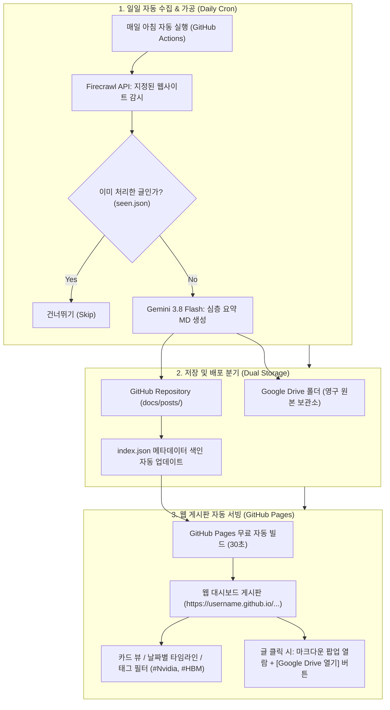

# Gemini AI 파이프라인 & 프로젝트 운영 종합 바이블
> **문서 목적**: Gemini API 요금제/쿼터 관리, 모델 선택 기준, 데이터 저장 포맷(MD vs JSON), 일일 자동화 파이프라인 아키텍처, 그리고 AI 에이전트 요청 프롬프트 가이드까지 지금까지 논의되고 검증된 모든 핵심 지식을 한눈에 참고할 수 있도록 정리한 종합 핸드북입니다.

---

## 목차
1. [Gemini API 요금제 및 쿼터 관리](#1-gemini-api-요금제-및-쿼터-관리)
2. [Gemini 3 Flash 모델 특성 및 활용법](#2-gemini-3-flash-모델-특성-및-활용법)
3. [저장 포맷 비교: Markdown vs JSON](#3-저장-포맷-비교-markdown-vs-json)
4. [자동화 파이프라인 & 웹 게시판 아키텍처](#4-자동화-파이프라인--웹-게시판-아키텍처)
5. [AI 어시스턴트 활용 프롬프트 가이드](#5-ai-어시스턴트-활용-프롬프트-가이드)

---

## 1. Gemini API 요금제 및 쿼터 관리

### 1) 개인 웹 챗봇 구독(Gemini Pro) vs 개발자 API(Google AI Studio)
* **완벽한 분리**: 구글 웹사이트(gemini.google.com)에서 결제하는 월 구독료(Google One AI Premium / Gemini Advanced)는 **개인 웹 채팅 전용**입니다.
* **토큰 영향 0%**: 파이썬 코드/API 키로 수백만 토큰을 사용하거나 쿼터가 소진되어도, **개인 계정의 Gemini Pro 웹 채팅 토큰이나 사용량은 단 1토큰도 차감되지 않습니다.**
* **과금 안전성**: 신용카드를 등록하지 않은 API 키는 무료 티어로 동작하여, 한도 도달 시 작업이 일시 중지될 뿐 추가 요금이 청구되지 않습니다.

### 2) 무료 티어(Free Tier)의 한계와 주의점
* **일일 요청 한도 (20 RPD)**: 구글은 최신 모델(`gemini-3.8-flash`, `gemini-3.7-flash` 등)의 무료 티어 호출을 **프로젝트당 하루 20회**로 엄격하게 제한합니다. 20회가 넘어가면 `429 RESOURCE_EXHAUSTED` 에러와 함께 약 12시간 동안 차단됩니다.
* **속도 제어 필요**: 분당 15회 / 100만 TPM 한도를 넘지 않도록 15초 이상의 강제 쿨다운이 필수적입니다.

### 3) 유료 티어(Pay-as-you-go) 전환 효과 및 지출 한도
* **압도적인 성능**:
  * 속도 한도: 분당 1,000 ~ 2,000회 (RPM)
  * 일일 한도: 20회 제한 완전 해제 (무제한)
  * 비용: Flash 모델 기준 100만 토큰당 약 $0.075 (약 100원). 300편의 방대한 리포트 전체를 요약해도 **총 500원~800원 수준**.
* **월간 지출 한도 (Monthly Spend Cap) 관리**:
  * 구글은 신규 유료 등록 시 계정 보호를 위해 초기 월 지출 한도를 $1 내외로 낮게 설정합니다.
  * 한도 초과 시 [https://ai.studio/spend](https://ai.studio/spend) 에서 한도를 $5~$10 정도로 올려주면 즉시 재개됩니다.

---

## 2. Gemini 3 Flash 모델 특성 및 활용법

### 1) Flash vs Pro 모델 비교
| 구분 | **Gemini Pro** (연구·심층설계형) | **Gemini 3 Flash** (대용량 일꾼형) |
| :--- | :--- | :--- |
| **속도** | 보통 (신중한 심층 추론) | **초고속 (Pro 대비 3~5배 빠름)** |
| **비용** | 상대적 고가 | **극도로 저렴 (Pro의 1/10~1/20)** |
| **컨텍스트 창** | 100만 ~ 200만 토큰 | **100만 ~ 200만 토큰 (대용량 동일)** |
| **추론 능력** | 깊은 멀티스텝 추론 | **Thinking Budget(생각하기) 지원으로 Pro급 요약** |
| **최적 용도** | 복잡한 아키텍처 기획, 정밀 코드 리팩토링 | **수백 편 글 일괄 요약, 대량 크롤링 정제, 분류** |

### 2) 대규모 데이터 파싱/정리/분류에 Flash가 최적인 이유
1. **깨지지 않는 지능형 파싱**: 전통적인 정규식(Regex)과 달리, 웹페이지 HTML이나 서식이 바뀌어도 문맥을 이해해 필요한 데이터만 정확히 JSON/마크다운으로 추출.
2. **100만 토큰 통째 입력 (No Chunking)**: 책 수십 권 분량의 글을 조각조각 자르지 않고 통째로 집어넣어 전체 맥락을 잃지 않고 요약.
3. **Thinking 결합**: 단순 겉핥기 요약이 아니라 내부적으로 2,048 토큰 이상 스스로 생각한 후 고품질 리포트를 출력.

---

## 3. 저장 포맷 비교: Markdown vs JSON

| 비교 항목 | **Markdown (.md)** | **JSON (.json)** |
| :--- | :--- | :--- |
| **순수 토큰 소모량** | **15~30% 절약 (매우 효율적)** | 문법 기호(따옴표, 괄호, 키 반복)로 토큰 낭비 |
| **사람의 가독성** | **최상** (옵시디언, 노션, 깃허브에서 바로 열람) | 낮음 (프로그램 파싱 필요) |
| **프로그램 필터링** | 낮음 (특정 항목만 발라내기 어려움) | **최상** (날짜, 태그, 키워드로 0.01초 필터링) |
| **재검색 시 토큰 절약** | 문서 전체를 LLM에 넣어야 해서 토큰 소모 | 필요한 필드만 뽑아 LLM에 주므로 **토큰 1/10 절약** |

### 💡 실무 권장 표준: "하이브리드 (YAML Frontmatter + MD)"
```markdown
---
title: "Vera Rubin NVL72 Agentic Inference"
date: "2026-09-14"
companies: ["Nvidia", "TSMC"]
tags: ["Inference", "Blackwell"]
---

# 1. 핵심 요약
본문 내용은 토큰 낭비 없는 순수 마크다운으로 작성...
```
* **결론**: 리포트 본문은 **Markdown**으로 저장하고, 대시보드 검색용 가벼운 **`index.json` 색인 파일**을 함께 만드는 것이 가장 이상적입니다.

---

## 4. 자동화 파이프라인 & 웹 게시판 아키텍처



* **핵심 역할 분담**:
  * **Google Drive**: 태블릿/스마트폰/구글 닥스에서 언제든 열람할 수 있는 개인 아카이브
  * **GitHub Pages**: 서버비 0원으로 전 세계에 0.05초 만에 열리는 초고속 웹 게시판
  * **`index.json`**: 300개 MD를 대시보드가 매번 읽지 않고 단 0.05초 만에 카드 뷰를 띄우는 핵심 색인

---

## 5. AI 어시스턴트 활용 프롬프트 가이드

AI 어시스턴트에게 다른 파일이나 새로운 작업을 요청할 때는 다음 패턴으로 말씀하시면 됩니다:

### 1) 이미 저장된 요약 파일을 찾거나 읽고 싶을 때
* *"2026년 9월 14일 Vera Rubin 요약 파일 보여줘"*
* *"가장 최근에 요약된 글 3개 핵심 내용만 알려줘"*
* *"엔비디아 블랙웰(Blackwell) 관련 요약본들 찾아서 내용 보여줘"*
* *"HBM 관련 글 중에서 결론만 3줄로 추려줘"*

### 2) 새로운 폴더의 파일이나 사이트를 요약하고 싶을 때
* *"`C:\practice\폴더명`에 있는 md 파일들도 이번처럼 똑같이 요약해줘"*
* *"https://example.com 사이트도 Firecrawl로 수집해서 오늘처럼 요약해줘"*

### 3) 파일 검색이나 데이터 추출을 요청할 때
* *"311개 요약 파일 중에서 OpenAI 관련 파일 목록만 다 찾아줘"*
* *"311개 요약 파일들에서 제목, 날짜, 기업명만 뽑아서 엑셀(CSV)로 만들어줘"*
* *"지금 만들어진 요약본들을 웹 대시보드용 `index.json`으로 일괄 변환해줘"*

---

> **관련 주요 파일 경로**:
> * 311개 요약본 저장소: [output/semianalysis/summary/](file:///C:/practice/Website_agent/url-monitor/output/semianalysis/summary)
> * 웹 게시판 상세 가이드: [docs/WEB_DASHBOARD_AUTOMATION_GUIDE.md](WEB_DASHBOARD_AUTOMATION_GUIDE.md)
> * 배치 요약 스크립트: [scripts/batch_summarize.py](file:///C:/practice/Website_agent/url-monitor/scripts/batch_summarize.py)
