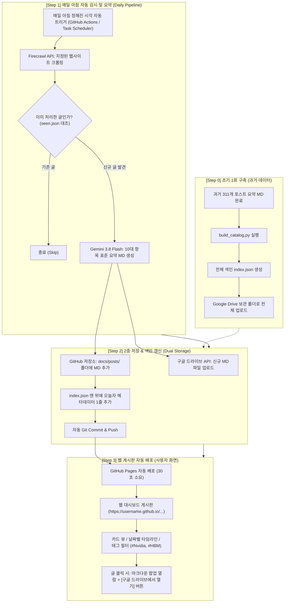

# 웹 배포 게시판 및 자동화 전체 구축 가이드
> **문서 목적**: 과거 아카이브 MD 파일과 매일 새롭게 크롤링·요약되는 리포트를 구글 드라이브와 깃허브에 2중 저장하고, 서버 비용 0원으로 실시간 웹 게시판(대시보드)에 자동 게재하기 위한 엔드투엔드(End-to-End) 아키텍처 가이드입니다.

---

## 1. 지금까지의 질의응답 핵심 총정리

| # | 질문 주제 | 핵심 요약 및 점검 결과 |
| :---: | :--- | :--- |
| **1** | **작업 언제 끝나냐 / 멈췄냐?** | 311개 요약 작업 중 36번째 파일에서 PC 절전 모드(Sleep) 및 이전 세션 분리로 중단되었음을 확인. 완료분(35개) 제외 후 잔여분 재개. |
| **2** | **한도 넘어가면 알려주고 멈춰라** | 무료 티어 분당 한도(429) 및 토큰 초과 발생 시 즉시 프로세스를 강제 중단(`--stop-on-429`)하고 사용자에게 알리는 2중 안전장치 탑재. |
| **3** | **Gemini Pro 요금제와 API의 차이** | 개인 웹 챗봇용 'Gemini Advanced (Google One)' 구독과 개발자용 'Google AI Studio API'는 완전히 분리되어 있어, **API를 써도 개인 구독 토큰은 전혀 차감되지 않고 추가 과금도 없음**을 규명. |
| **4** | **결제 후 429 멈춤 원인 및 해결** | 기존 키는 무료 티어 프로젝트(20회/일 한도)에 묶여 있었음을 에러 코드로 포착. 결제가 연결된 **새 유료 API 키**를 발급받아 교체함으로써 일일 제한 해제 완료. |
| **5** | **지출 한도(Spend Cap) 도달 및 조치** | 구글 신규 유료 등록 시 기본 설정된 '월간 지출 한도(Monthly Spend Cap, $1)'에 도달하여 안전 중단된 것을 확인. [ai.studio/spend](https://ai.studio/spend)에서 상향 조정 후 즉시 정상 재개. |
| **6** | **Gemini 3 Flash API의 정체** | Pro 대비 1/10~1/20의 극저렴한 비용, 분당 수천 회의 처리량, 100만 토큰 대용량 통째 입력, 3세대만의 추론(Thinking) 능력을 갖춘 **대용량 데이터 파이프라인의 핵심 일꾼**. |
| **7** | **Markdown vs JSON 저장 효율** | **순수 텍스트 토큰은 Markdown이 15~30% 절약** (문법 기호/반복 키 없음). 단, 나중에 특정 조건 필터링/검색 시에는 메타데이터 색인(`index.json`)을 병행하는 하이브리드 구조가 최적. |

---

## 2. 전체 시스템 설계 핵심: "역할 분담 원칙"

구글 드라이브와 깃허브를 결합할 때, **웹사이트가 구글 드라이브의 수백 개 MD 파일을 실시간으로 매번 API로 읽어오게 만들면 안 됩니다** (속도가 수십 초 걸리고, 구글 OAuth 인증이 복잡해집니다).

따라서 다음과 같이 **역할을 완벽하게 분담**합니다:

* **Google Drive**: **"나만의 영구 원본 보관소"** (모바일·태블릿·구글 닥스에서 안전하게 열람 및 소장)
* **GitHub Repository**: **"자동화 엔진 & 데이터베이스"** (매일 아침 자동 실행 + 파일 버전 관리)
* **GitHub Pages**: **"무료 웹 게시판 호스팅"** (서버 유지비 0원으로 전 세계에 0.05초 만에 열리는 웹사이트 제공)
* **`index.json` (색인 파일)**: **"대시보드의 고속 엔진"** (수백 개 MD의 제목·날짜·태그·링크만 모아둔 가벼운 색인)

---

## 3. 웹 배포 게시판 및 자동화 전체 순서도



---

## 4. 단계별 상세 동작 흐름

### [1단계] 초기 아카이브 적재 (311개 과거 데이터)
1. 311개 요약 MD 파일에서 **[제목, 날짜, 태그, 한줄 요약, 원문 URL]**을 추출합니다.
2. 이를 모아서 하나의 가벼운 **`docs/index.json`** 파일로 빌드합니다.
3. 311개 MD 파일 전체를 구글 드라이브의 지정 폴더(예: `My Drive/SemiAnalysis_Archive`)로 업로드합니다.

### [2단계] 매일 아침 데일리 파이프라인 (완전 자동화)
매일 아침 지정된 시각에 **GitHub Actions**(클라우드 무료 실행기) 또는 **로컬 작업 스케줄러**가 자동 실행됩니다:
1. **Firecrawl 수집**: 감시 대상 사이트의 최신 글 목록을 스크래핑합니다.
2. **중복 검사**: `seen.json`을 확인하여 오늘 새로 올라온 글만 감지합니다.
3. **Gemini 3.8 Flash 요약**: 신규 글 전문을 읽고 표준화된 마크다운 리포트로 요약합니다.
4. **구글 드라이브 저장**: 구글 드라이브 API(또는 데스크톱 동기화 폴더)를 통해 오늘자 요약 MD를 업로드합니다.
5. **깃허브 갱신**: 신규 MD 파일을 `docs/posts/`에 추가하고, `docs/index.json` 최상단에 오늘 글 정보를 추가한 뒤 깃허브로 푸시(Push)합니다.

### [3단계] 웹 게시판 자동 업데이트 (사용자 열람)
1. 깃허브에 푸시되는 즉시 **GitHub Pages**가 30초 만에 웹사이트를 자동 갱신합니다.
2. 사용자가 웹사이트(`https://아이디.github.io/프로젝트명`)에 접속하면:
   * **초고속 로딩**: 0.05초 만에 `index.json`을 읽어와 오늘 아침에 업데이트된 글이 게시판 맨 위에 떠 있습니다.
   * **검색 & 태그 필터**: 엔비디아, TSMC, 전력망, HBM 등 키워드를 누르면 즉시 관련 글들만 실시간 필터링됩니다.
   * **마크다운 뷰어**: 글을 클릭하면 브라우저 안에서 예쁜 폰트와 표가 적용된 마크다운 본문이 모달(팝업)로 즉시 열립니다.
   * **구글 드라이브 연동**: 우측 상단에 **[Google Drive에서 원본 열기]** 링크가 함께 제공되어 필요 시 개인 드라이브로 바로 넘어갈 수 있습니다.

---

## 5. 데이터 규격 (Data Specification)

### 1) 색인 파일 구조 (`docs/index.json`)
대시보드가 0.1초 만에 화면을 띄우기 위해 사용하는 가벼운 메타데이터 색인입니다:

```json
[
  {
    "id": "2026-09-14-rubin",
    "title": "Vera Rubin NVL72 Agentic Inference",
    "date": "2026-09-14",
    "source_url": "https://semianalysis.com/...",
    "drive_url": "https://drive.google.com/file/d/1a2b3c4d...",
    "post_file": "posts/2026-09-14_Vera_Rubin_NVL72_summary.md",
    "tags": ["Nvidia", "HBM", "Agentic Inference"],
    "one_line_summary": "루빈 NVL72 아키텍처 분석: 랙 스케일 추론 집적도 및 HBM 인터커넥트 최적화 상세 정리"
  }
]
```

---

## 6. 아키텍처의 핵심 이점 및 추천 부가 기능

1. **서버 유지비 0원**:
   * 백엔드 웹 서버(AWS, 리눅스 서버 등)를 24시간 켜둘 필요가 전혀 없습니다.
   * GitHub Pages(웹 호스팅)와 GitHub Actions(스케줄러) 모두 **평생 무료**입니다.
2. **속도와 안정성 (로딩 0.1초)**:
   * 구글 드라이브 API의 느린 로딩 속도나 권한 만료 오류에 웹사이트가 전혀 영향을 받지 않습니다.
3. **데이터 유실 위험 제로 (2중 백업)**:
   * 내 구글 드라이브에도 차곡차곡 MD 파일이 쌓이고, 깃허브 코드 저장소에도 버전별로 안전하게 백업됩니다.
4. **[추천] 이메일 다이제스트 연동 (Resend)**:
   * 웹 게시판에 글이 올라가는 동시에, **"오늘의 핵심 브리핑"**을 요약해서 내 이메일로 아침마다 자동 발송(프로젝트 내 `RESEND_API_KEY` 활용)하면 출근길에 간편히 확인할 수 있습니다.
